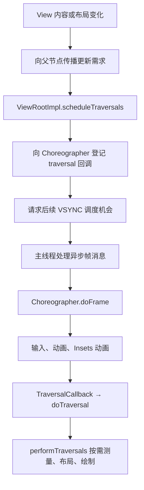
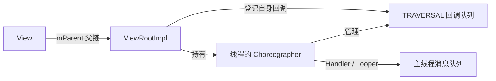
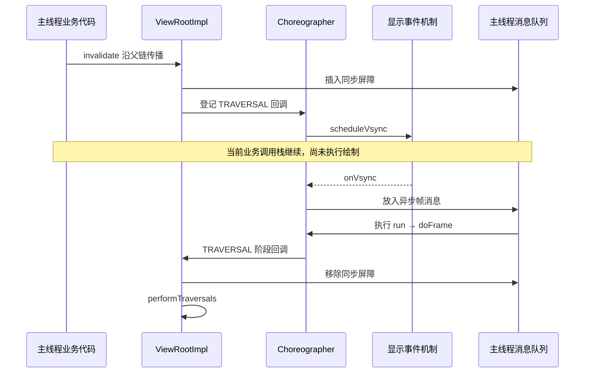

**Android View：一帧如何被触发——源码阅读与实验笔记**

**1. 范围与证据**

目标：解释一次普通、已附着、可见且开启硬件加速的 View 更新，如何进入 App 主线程的帧调度和 traversal。源码根目录为 `/mnt/data/airdrop/android/aosp-core`。

本文结论来自静态源码阅读，未在设备上执行实验。当前会话此前启动 ADB 时，监听 socket 被环境拒绝。以下实验是供设备执行的步骤，不是已观察到的日志或测试结果。

暂时把 native VSYNC 分发、RenderThread/GPU 执行和最终呈现作为外部接口；本篇关注主线程如何开始一帧。

**2. 先区分四件事**

- 内容或布局发生变化：产生更新需求。
- Choreographer 执行 doFrame：处理这一帧到期的回调。
- ViewRootImpl 执行 traversal：按需测量、布局、绘制。
- 缓冲区最终显示：还需要渲染、合成与呈现。

以上不是一一对应。单独注册 FrameCallback 可以触发 doFrame，但不一定绘制 View；多次 invalidate 可以合并到一次 traversal；一次 traversal 也不保证产生新的屏幕画面。

**3. 总体协作**

这是常见的帧间请求流程。在正在执行的 doFrame 中，前一阶段登记的更新，也可能进入同一帧尚未执行的后续阶段。

**4. 核心对象与状态**

| 对象或状态 | 谁持有或改变 | 需要回答的问题 |
|---|---|---|
| View.mParent | View 树及根节点连接 | 更新沿哪条父链到达根部？ |
| View 的 dirty / invalidated / force-layout 标记 | View 更新入口与布局绘制流程 | 内容过期和布局过期有什么区别？ |
| ViewRootImpl.mLayoutRequested | 根部布局请求及 traversal | 本轮是否有布局需求？ |
| ViewRootImpl.mTraversalScheduled | scheduleTraversals / doTraversal | 根部是否已登记一次待执行 traversal？ |
| ViewRootImpl.mChoreographer | 构造时取得对应线程实例 | 谁管理帧回调队列？ |
| Choreographer.mCallbackQueues | 按阶段保存 CallbackRecord | 回调在哪个阶段执行？ |
| Choreographer.mFrameScheduled | scheduleFrameLocked / doFrame | 是否已安排待处理帧？ |
| 同步屏障 token | ViewRootImpl 保存，MessageQueue 管理 | 为什么普通消息会等待，而异步帧消息能继续？ |

这里描述普通主线程 UI 场景。Choreographer 是按线程取得的，不是整个进程只能存在一个；同一主线程上的多个根通常共享该线程的调度实例。

**5. 主线 A：invalidate**

场景：自定义 View 的颜色变量改变，并调用 invalidate。

1. `View.invalidate()` → `invalidateInternal()`：满足附着、尺寸、可见性和标记等条件时，记录内容过期并向父节点传播。
2. `ViewGroup.invalidateChild()`：硬件加速分支进入 `onDescendantInvalidated()`，继续向根部传播。不要把软件绘制的脏矩形传播当成唯一实现。
3. `ViewRootImpl.onDescendantInvalidated()` → `invalidate()`：根部记录更新需求，合适时调用 `scheduleTraversals()`。
4. `scheduleTraversals()`：若 mTraversalScheduled 已为 true，则不重复登记。否则置 true，插入同步屏障，并登记 TRAVERSAL 阶段回调。
5. 当前分支使用 `postVsyncCallback(CALLBACK_TRAVERSAL, mTraversalCallback)`，回调类型是 `TraversalCallback implements Choreographer.VsyncCallback`。旧资料里的 TraversalRunnable/postCallback 表达相似职责，但名称不同。
6. Choreographer 将回调加入对应队列，调用 `scheduleFrameLocked()`。mFrameScheduled 避免重复安排待处理帧。通常通过 DisplayEventReceiver 请求 VSYNC。
7. 事件返回后，`FrameDisplayEventReceiver.onVsync()` 将异步消息放入主线程消息队列。消息得到执行时，`run()` 调用 doFrame。
8. doFrame 依次处理 INPUT、ANIMATION、INSETS_ANIMATION、TRAVERSAL、COMMIT。
9. traversal 回调进入 `doTraversal()`：清除待执行标记、移除同步屏障、执行 `performTraversals()`。
10. traversal 根据布局请求、配置、可见性、绘制条件等决定工作，并非每次都完整重做所有 View 的 measure/layout/draw。

图中事件接收和帧回调分为两个时刻；onVsync 本身也需要主线程有机会处理 native 事件。这里是源码关系，不是设备抓取的调用栈。

**6. 主线 B：requestLayout 和首次显示**

`View.requestLayout()` 设置强制布局等标记，合适时沿父链传播。根部 `requestLayout()` 设置 mLayoutRequested，并进入相同的 scheduleTraversals 路径。

区别在需求：invalidate 表示内容过期；requestLayout 表示布局计算需要更新。后者不能简单描述成始终对整棵树强制重做三阶段，是否执行、重复执行、命中测量缓存等要看具体条件。自定义控件同时改变固有尺寸和内容时，常需要同时表达布局和绘制需求。

首次显示也会进入调度：当前源码 `ViewRootImpl.setView()` 中调用 requestLayout，安排首次布局。初次 inflate 与真正执行首次测量布局不是同一时刻。

**7. 为什么合并请求，为什么还需要消息队列**

两层合并解决不同的问题：mTraversalScheduled 避免同一根重复登记 traversal；mFrameScheduled 避免对应 Choreographer 重复安排待处理帧。View 自身的 dirty 标记也可能提前省掉重复传播。

同步屏障让到达屏障的队列处理跳过普通同步消息，寻找可执行的异步消息；帧消息被标为异步。异步表示消息队列调度属性，不表示它运行在另一个线程。屏障不能打断正在执行的主线程方法，不能让布局与业务代码同时运行，也不意味着所有异步消息都比所有同步消息优先。

doTraversal 在进入 performTraversals 前移除屏障，但普通消息仍要等当前主线程调用栈结束后才有机会执行。

与固定 16ms 定时器相比，显示节奏相关的调度能适配不同刷新率与时序。屏障则协调帧任务与普通消息的顺序。作为教学实现，我会先搭建无屏障的最小回调队列验证批处理，再增加屏障；生产实现是否能简化，要先验证已有消息顺序契约，不能直接删除它。

**8. 需要特别理解的边界**

- VSYNC 不是强迫每个 App 每个周期调用 onDraw。静止窗口可以复用已有内容。
- `postFrameCallback` 是一次性回调，默认处于 ANIMATION 阶段；仅注册它不等于请求 View 绘制。
- 动画阶段调用 invalidate，可能赶上同一 doFrame 的 TRAVERSAL 阶段。doCallbacks 到执行该阶段时才提取已到期回调。
- 在某阶段回调队列已经取出之后，再向该阶段登记回调，一般需后续帧处理。不要将“下一帧”用作所有调用时机的统一结论。
- `frameTimeNanos` 是动画使用的帧时间基准，不等于回调函数真正开始执行的当前时间。
- 60Hz 周期约 16.67ms、120Hz 约 8.33ms；具体 App 截止时间还涉及调度和渲染流水线。
- 主线程 doFrame 结束、View.onDraw 结束、GPU 完成、缓冲区呈现，是不同事件。
- `CALLBACK_COMMIT` 是 Choreographer 的回调阶段，不表示 SurfaceFlinger 已提交或画面已呈现。

**9. 实验准备**

在普通 View Activity 中放一个自定义 ProbeView，宽高先固定，待页面首次显示稳定后操作。仅对 ProbeView 使用单独的日志 tag，避免按钮按下反馈、输入法、布局变化等干扰判断。每个实验分开执行。

在 ProbeView 的 onMeasure/onLayout/onDraw 中记录调用次数、System.nanoTime 和线程名。正常调用 super；onDraw 绘制一个由字段控制颜色的矩形。先不在 onDraw 内发起后续更新。

建议日志格式：`FrameProbe: event=draw count=3 ns=... thread=main`。用 `adb logcat -v threadtime -s FrameProbe:I '*:S'` 查看。

计数用于机制实验；性能分析时用 Trace 标记和 Perfetto，避免逐帧日志本身影响测量。以下期望均是待验证假设。

**实验 A：invalidate 的异步性**

在一个点击回调内依次记录 before、改变颜色字段、调用 invalidate、记录 after。观察 ProbeView.onDraw 是否在 after 之后执行。解释为何 setter 和 invalidate 返回时尚未执行该次绘制。

**实验 B：合并请求与状态采样**

在同一个点击回调里循环 10 次，每次改变颜色字段并 invalidate。观察绘制次数和最终颜色。简单稳定条件下通常合并，并绘制最后的状态，不能据此宣称任何环境下永远只有一次 onDraw。

回答：如果没有保存中间状态和逐帧调度，为什么 10 个赋值不能产生 10 个可见画面？

**实验 C：布局需求与绘制需求**

分别执行：只改颜色并 invalidate；切换 ProbeView 的 layoutParams.width 后重新设置 layoutParams；同时改变自定义固有尺寸与内容并 requestLayout/invalidate。比较三类回调计数。不要要求每次都精确为 1；测量可能多次，也可能受缓存与父布局策略影响。

**实验 D：帧回调不等于绘制**

在主线程 postFrameCallback，只记录 frameTimeNanos 和 System.nanoTime，不修改 View。页面稳定时，可能出现 FrameCallback 日志而 ProbeView.onDraw 不增加。再次观察它是否自动持续调用，验证一次性语义。

**实验 E：主线程阻塞**

在点击回调里 invalidate 后，额外 sleep 50ms，再退出点击回调。仅用于故意制造延迟的实验。用日志/trace 验证绘制不会抢占这 50ms，也不会跑到后台线程。不要把日志时间差直接等同于最终呈现延迟。

**实验 F：同一帧的阶段衔接**

在一个 postFrameCallback 中记录时间、改颜色并 invalidate。用 Perfetto 观察动画回调和 traversal 是否位于同一次 Choreographer#doFrame 中。比对源码 doCallbacks 的提取时机。

进阶：实现一个生命周期受控的 FrameCallback，每次使用帧时间计算位置，并重新注册自己，页面暂停时停止注册；不要用固定每回调移动若干像素的方式假定刷新率。

**10. 阅读顺序与入口**

1. `frameworks/base/core/java/android/view/ViewRootImpl.java:3307`：scheduleTraversals，先掌握合并、屏障、登记回调三件事。
2. `frameworks/base/core/java/android/view/Choreographer.java:919`：scheduleFrameLocked。
3. 同文件 `:1579`：FrameDisplayEventReceiver，以及 onVsync/run。
4. 同文件 `:1074`：doFrame，先看阶段顺序，再看 doCallbacks 的到期队列提取。
5. `ViewRootImpl.java:11445`：TraversalCallback；`:3347`：doTraversal。
6. 同文件 `:3924`：performTraversals，第一轮只定位布局条件、measure/layout/draw 和取消绘制条件。
7. 回头读 `View.java:21431` 的 invalidate、`:28723` 的 requestLayout；`ViewGroup.java:6244` 的硬件加速分支；`ViewRootImpl.java:2842` 的根部处理。
8. 进阶：`ViewRootImpl.java:1741` 的首次布局；`android/os/LegacyMessageQueue/MessageQueue.java` 的同步屏障。当前树中 MessageQueue 有多种实现，Legacy 便于理解经典语义，但不能直接断言设备启用了它。

每读一个入口写下：调用者、改变的状态、登记的工作、后续执行线程、是否立即执行绘制。

**11. 暂时保留的外部接口与后续问题**

| 接口 | 输入与作用 | 后续学习问题 |
|---|---|---|
| DisplayEventReceiver.scheduleVsync | 请求后续显示节奏事件 | native 如何向系统申请、接收事件？ |
| ThreadedRenderer.draw | 接收 View 绘制工作 | RenderNode 与 RenderThread 如何分工？ |
| performTraversals 中的窗口交互 | 获取或更新窗口、Surface 等状态 | 为什么首次绘制和尺寸变化有额外工作？ |

当前无需展开 GPU、BufferQueue、fence 和驱动；等主线程调度机制掌握后继续。

**12. 自测题**

1. invalidate 为什么不直接调用 onDraw？
2. requestLayout 与 invalidate 分别表达什么需求？
3. 为什么同一个点击回调中的 10 次 invalidate 通常不会产生 10 次绘制？
4. mTraversalScheduled 与 mFrameScheduled 的职责有何区别？
5. VSYNC 到了，主线程忙着执行方法时会发生什么？
6. 异步帧消息为什么仍然运行在主线程？
7. ANIMATION 阶段安排的更新，何时可能进入同一帧 traversal？
8. doFrame 为什么可能没有对应的 onDraw？
9. 静止页面为什么不需要每个刷新周期重画？
10. onDraw 结束为什么不能作为用户已看到画面的证据？

完成标准：能够从入口独立画出调度流程，解释关键标记，并用至少 A、B、D、E 四个实验的实际日志佐证。
